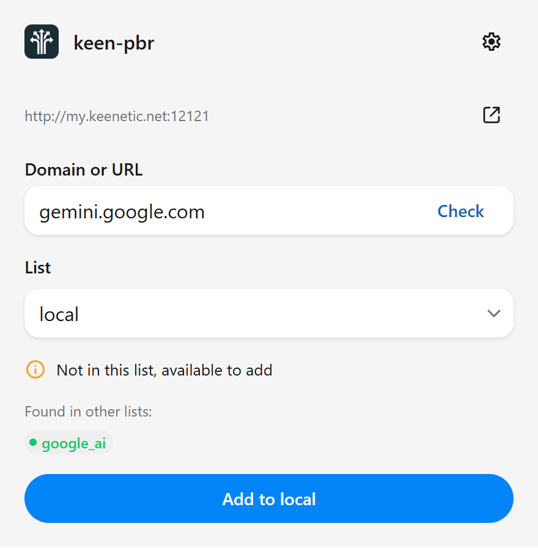
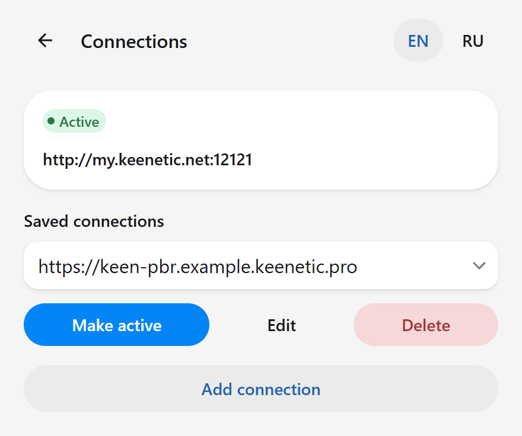
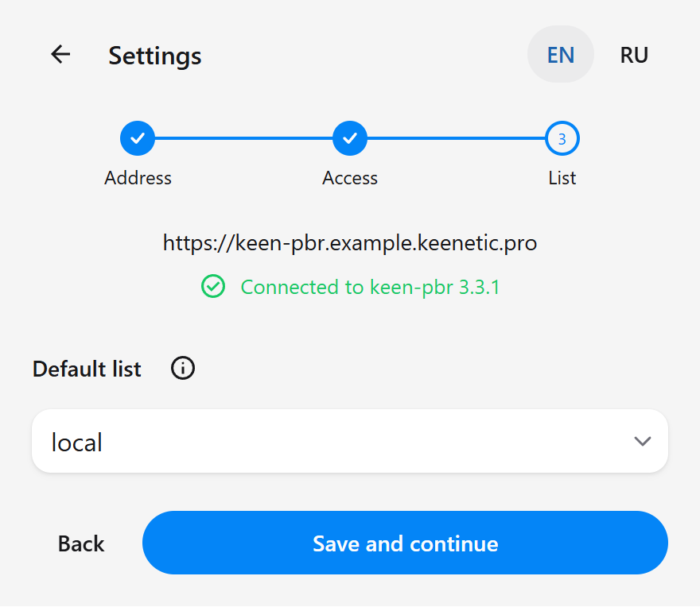

[Русская версия](README.ru.md)

# keen-pbr Quick Add

Add or remove website domains in keen-pbr directly from Chrome.
Independent, unofficial beta extension.

## Screenshots

Domain checks, saved connections, and guided setup.

  
  
  

Example data. Click a screenshot to view it full size.

## Install

1. Download the ZIP from [Releases](https://github.com/bakkewhite/keen-pbr-quick-add/releases) and extract it to a permanent folder.
2. Open `chrome://extensions` and enable **Developer Mode**.
3. Choose **Load unpacked** and select the folder containing `manifest.json`.

Do not move or delete that folder while the extension is installed.

Requires Chrome/Chromium 120+, full keen-pbr with its API enabled, and a nonempty
domain list used by an active routing rule.

## Connect

1. Enter the keen-pbr Web UI address. **Use local address** fills
   `http://my.keenetic.net:12121`; enter a different address or port manually.
2. Press **Continue**, allow Chrome access, and enter the keen-pbr password if requested.
3. Choose the default list and finish setup.

Use a reachable HTTPS KeenDNS address for remote access. Local addresses require
the router's network or a VPN into it. Saved connections are managed in Settings;
they do not switch automatically.

## Use

Open the extension on a website or enter a domain/URL manually.
**Check** checks membership, removes URL components and the `www.` prefix, and preserves other subdomains. Addresses from the current tab follow the same rule.
Then choose a list and press **Add to [list]** or **Remove from [list]**.

Only the selected list changes. Choosing another list here does not change your
saved default. Matches in other lists are shown for information; subscription
matches may be incomplete. URL/file subscriptions and IP lists cannot be edited.

## Password and privacy

Use the **keen-pbr password**, not your Keenetic account. Signing into the Web UI
does not sign the extension in.

HTTP sends the password without encryption: use HTTPS or a trusted local network.
Passwords normally stay until Chrome closes. **Remember on this computer** stores
them in the Chrome profile without synchronization; programs with profile access
can read them. The extension has no telemetry.

[Privacy](PRIVACY.md) · [Security](SECURITY.md) ·
[Development and troubleshooting](CONTRIBUTING.md) · [Changelog](CHANGELOG.md) ·
[GPL-3.0 license](LICENSE)
