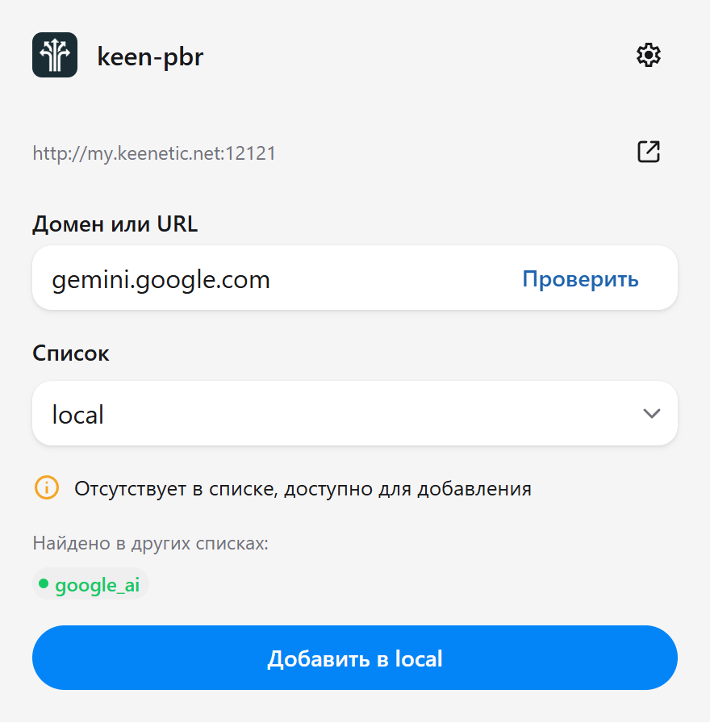
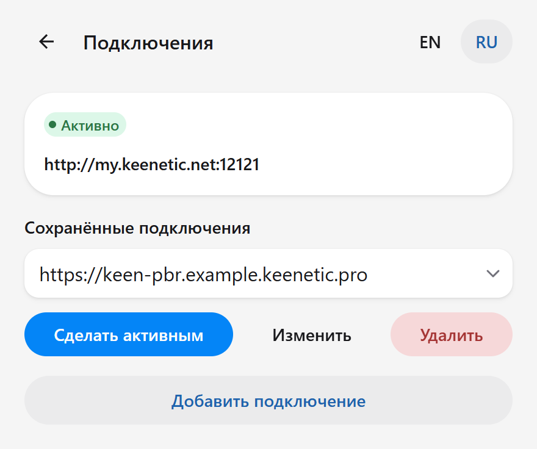
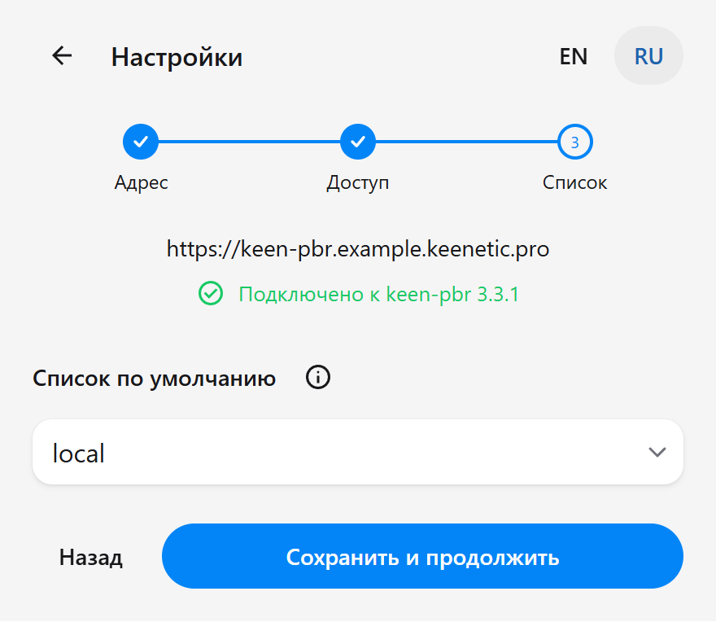

[English version](README.md)

# keen-pbr Quick Add

Добавляйте и удаляйте домены сайтов в списках keen-pbr прямо из Chrome.
Независимое неофициальное расширение, beta-версия.

## Скриншоты

Проверка доменов, сохранённые подключения и пошаговая настройка.

  
  
  

Демонстрационные данные. Нажмите на скриншот, чтобы открыть его в полном размере.

## Установка

1. Скачайте ZIP из [Releases](https://github.com/bakkewhite/keen-pbr-quick-add/releases) и распакуйте в постоянную папку.
2. Откройте `chrome://extensions` и включите **Режим разработчика**.
3. Нажмите **Загрузить распакованное расширение** и выберите папку с `manifest.json`.

Не перемещайте и не удаляйте эту папку, пока расширение установлено.

Нужны Chrome/Chromium 120+, полный keen-pbr с включённым API и непустой список
доменов в активном правиле маршрутизации.

## Подключение

1. Укажите адрес Web UI keen-pbr. **Использовать локальный адрес** подставляет
   `http://my.keenetic.net:12121`; другой адрес или порт впишите вручную.
2. Нажмите **Продолжить**, разрешите Chrome доступ и введите пароль keen-pbr, если он запрошен.
3. Выберите список по умолчанию и завершите настройку.

Для удалённого доступа используйте доступный HTTPS-адрес KeenDNS.
Локальный адрес работает в сети роутера или через VPN в эту сеть.
Сохранёнными подключениями можно управлять в Настройках; автоматически они не переключаются.

## Использование

Откройте расширение на сайте или введите домен/URL вручную.
**Проверить** проверяет присутствие в списках, убирает части URL и префикс `www.`, сохраняя остальные поддомены. Для адреса из вкладки действует то же правило.
Затем выберите список и нажмите **Добавить в [список]** или **Удалить из [списка]**.

Изменяется только выбранный список. Его выбор здесь не меняет сохранённый список
по умолчанию. Совпадения в других списках показаны для информации; совпадения
в подписках могут быть неполными. URL/файловые подписки и IP-списки здесь не редактируются.

## Пароль и конфиденциальность

Нужен **пароль keen-pbr**, не учётной записи Keenetic. Вход в Web UI
не авторизует расширение.

По HTTP пароль передаётся без шифрования: используйте HTTPS или доверенную локальную сеть.
Обычно пароль хранится до закрытия Chrome. **Запомнить на этом компьютере** сохраняет
его в профиле Chrome без синхронизации; программы с доступом к профилю могут его прочитать.
Расширение не собирает телеметрию.

[Конфиденциальность](PRIVACY.md) · [Безопасность](SECURITY.md) ·
[Разработка и диагностика](CONTRIBUTING.md) · [Changelog](CHANGELOG.md) ·
[Лицензия GPL-3.0](LICENSE)
